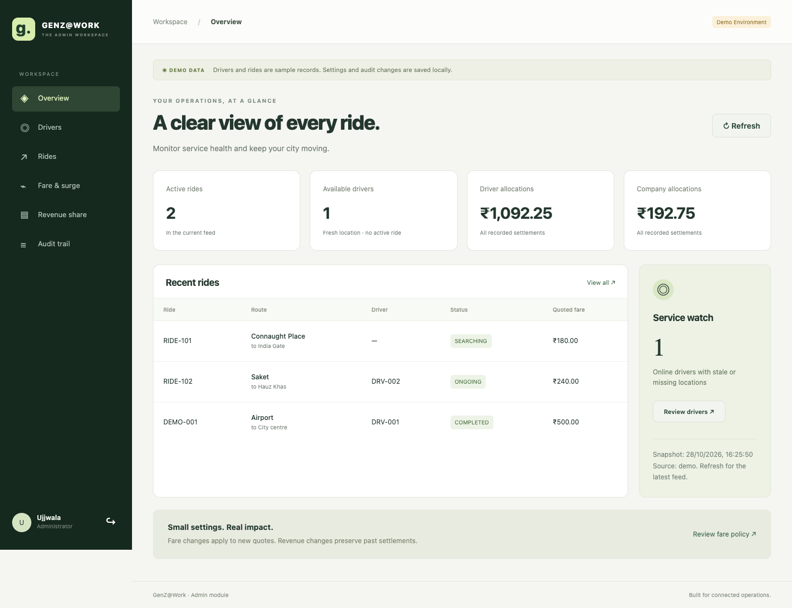

# GenZ@Work — Ujjwala’s admin module

Standalone React/Vite + Flask admin implementation of pages 9–15 of the supplied guide. Includes persistent settings, circular scheduled surge zones, 85/15 revenue settings, audit history, allocation ledger and operations monitoring. No paid API keys or SQL Server installation required for the local demo.



## Start on your MacBook M1

You need Python 3.11+ and Node 22.12+ (LTS recommended).

```sh
cd ~/taxi-admin
python3 run.py setup
python3 run.py
```

Open **http://127.0.0.1:5173/admin** and click **Open demo workspace**. This is a development shortcut, not your teammates’ mobile/password login. The demo admin identity is Ujjwala.

Dependencies and demo database have already been installed on the Mac where this project was created. You can start directly with `python3 run.py` there.

## Start on Windows

Extract the source ZIP into a folder, install Python 3.11+ and Node 22.12+, then open PowerShell in that folder:

```powershell
py run.py setup
py run.py
```

No virtual environment activation, Bash commands or PowerShell execution-policy changes are needed. Never copy `.venv` or `node_modules` from macOS to Windows: setup recreates them locally.

Press Ctrl+C to stop both servers. Settings survive restarts in `backend/demo.db`. Demo bearer tokens last one hour and remain only in browser memory; reopen the workspace after expiry or a backend restart.

## What works

- Overview with active rides, available drivers, stale locations and recorded allocations.
- Searchable driver/ride monitoring, with refresh and explicit errors when a real provider is missing.
- Fare rules: base, distance, duration, minimum, global surge switch and cap.
- Create/edit/disable circular surge zones with local timezone, weekdays and overnight schedules.
- Fare preview using manually entered route distance/duration; not Google Maps routing.
- Revenue split validation, historical settings, paise rounding and settlement snapshots.
- Paginated settlement ledger and before/after audit records with actor and change reason.
- Backend JWT admin enforcement, request IDs, optimistic update conflicts, decimal money and database constraints.
- Alembic migrations and interactive Swagger UI at http://127.0.0.1:5001/api/docs/.

**Demo boundary:** rides and drivers are explicitly sample data. Settings, audit records and seeded allocations are stored in the real local database. Your teammates’ auth, live rides, locations, route provider and ride completion must be connected using [the integration guide](docs/INTEGRATION.md). The admin screens do not directly change driver or ride status.

## Share these files now

Send teammates [TEAM_CONTRACT.md](docs/TEAM_CONTRACT.md) before they finalize APIs. Keep `docs/swagger.json` in the shared repository. Your module can run independently now, but no independently developed code can guarantee zero integration changes without the team agreeing to the same contracts.

Read [INTEGRATION.md](docs/INTEGRATION.md) for authentication, shared database/session, quote and settlement hooks. Read [DEMO_WALKTHROUGH.md](docs/DEMO_WALKTHROUGH.md) for presentation steps.

## Checks

```sh
python3 run.py test
```

Windows: `py run.py test`. This runs backend tests and the frontend production build. SQL Server DDL compilation is tested; an actual SQL Server connection still needs team credentials and integration testing. See [VERIFICATION.md](docs/VERIFICATION.md) for executed checks.

## Layout

```text
backend/admin_module/   Mountable blueprint, services, repository, auth and models
backend/migrations/     Versioned schema, no teammate table ownership
backend/tests/          Auth, prices, schedules, conflicts, settlement and API checks
frontend/src/           React admin route tree, API adapter and styling
docs/                   Contracts, setup/integration notes and Swagger JSON
run.py                  macOS/Windows setup and launcher
```

## Database choice

SQLite is the portable demo backend, not a claim that SQL Server has been tested. Integration supports `mssql+pyodbc` via `DATABASE_URL`. Install pyodbc plus Microsoft ODBC Driver 18 on each connecting machine and use a shared SQL Server/Azure SQL instance. Microsoft supports SQL Server containers on x86-64 Linux, not Apple Silicon emulation: [Microsoft container documentation](https://learn.microsoft.com/en-us/sql/linux/quickstart-install-connect-docker?view=sql-server-ver17). Connection configuration: [SQLAlchemy SQL Server documentation](https://docs.sqlalchemy.org/en/20/dialects/mssql.html#module-sqlalchemy.dialects.mssql.pyodbc).

No production secrets are included. Keep `.env` out of Git. This is a local college-project module, not a completed production taxi system.
